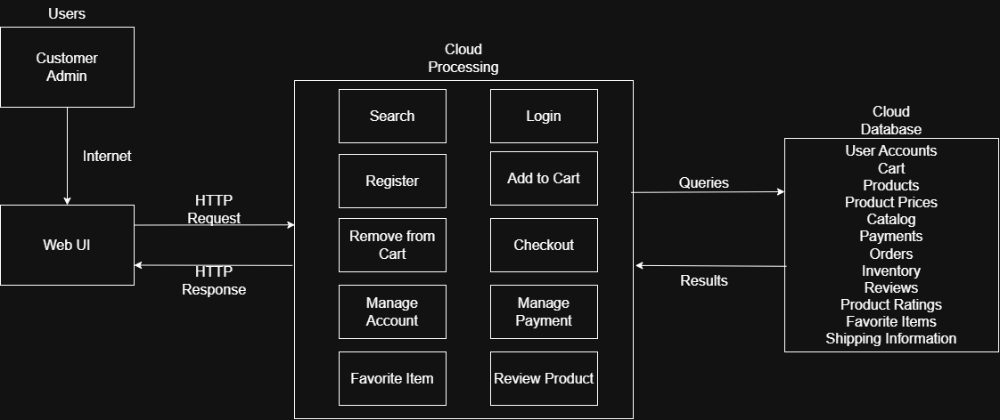

# eShopping-platform
CSC 131 repository for our eShopping Platform project

## Project information:
eShopping Platform, called Whole Eats Shopping, will be an online web-based ecommerce application designed to allow shoppers to view gorcery products, purchase itemsm and rate produts; the site admistrator will be able to add and to update the store catelogue.

For this prototype (iteration 1), we will be running this on a Live Server, where only each of us (teammates) can run a local copy of the same code and files, through our GitHub repository. We chose to do this for this iteration because this is our :first draft" and the design is still in some progress, or will require some touch ups. This is also a more instant way for us to update and deploy our UI for now, though we do plan on hosting through the cloud in later iterations.

## Architecture diagram:

## Development tools:
We got all of our picture for the products on Unsplash, as well as using Git and GitHub/GitHub desktop to share our team's repository and commiting, pushing, and pulling.

Languages: 
    - HTML for page structures
    - CSS for styling and the webpage layout
    - JavaScript for building the product cards and the buttons

Design:
    the UI design was built on Figma and translated into our coded files after deciding on a webpage layout.

Environment:
    We used a few different enviroments to develop this first iteration such as: VS Code, and Live servers. We used VS Code as our main code editor and the Live Server to locally preview our saves on the files.

## Reflection:
    Hailey: For this part of the project, I worked on the front-end development of the UI design. I helped add to our css, js, and html files to achieve what we wanted to for this first iteration of our project. One thing I found somewhat challenging was figuring out the languages, since I haven't used any of them before; after doing a bit of research and getting some help, I was able to figure it out and get a grasp on how the language work independently as well as along with each other to build a [visual] webpage. A challenge I felt that we had as a group was not being able to work together in person, as it can be difficult not being able to directly communicate to each other.

    Fatema: For our first prototype, we decided to work on the UI, so mainly front-end development. After the determining the design we wanted for the UI, I assisted in the front-end development process and worked with VS code, html, css, and javascript to build the UI prototype. It was definitely challenging to work on the UI because I had to get learn how to use all three languages cohesively. I am fairly new to both css and Javascript, so it took a little research time to learn how to work with them. One challenge the team faced was communication. This definitely slowed us down a bit. As for our plans for the next iteration, we still plan on continuing our work on the UI, but we will dive more into the middleware and back-end development as well to add some features/functions to the project (redirect to different pages, etc). 

    Kylie:

    Joe:I set up the initial project structure and pushed it to GitHub which allowed for a collaborative workflow. I had to some research and see what folder structure would work best for the project. Considering the nature of the project, went with client and eventual server folder structure. Only the folders and files needed for the current prototype were created. One challenge I had was figuring out the proper Git commands when it comes to the collaborative aspects of Git/GitHub but after searching online, i figured out the process and workflow.
